<a href="https://meet-miit.vercel.app">
  <picture>
    <source media="(prefers-color-scheme: dark)" srcset="./assets/header-night.svg">
    
  </picture>
</a>

**ML/AI engineer in Mumbai.** Three years across medical devices, speech and language models. I build systems, then audit them, then audit the audit.

The full training log lives at **[meet-miit.vercel.app](https://meet-miit.vercel.app)**. It has a temperature dial that sets how unhinged the copy gets. Start cold.

### 03 / held-out set

| run | system | what I found |
|:--|:--|:--|
| [01](https://meet-miit.vercel.app/projects/intraday-trading) | Intraday trading system | The headline return came from one month. The framework that proved it is the deliverable. |
| [02](https://meet-miit.vercel.app/projects/haemoglobin-screening) | Non-invasive haemoglobin screening | The accuracy problem was never the model: no two devices agreed. Calibrate the fleet, then the model. |
| [03](https://meet-miit.vercel.app/projects/lateral-flow-reader) | Lateral-flow strip reader | 40 and 50 mIU/mL produce the same colour. Saying so early redirected the product, and it shipped. |
| [04](https://meet-miit.vercel.app/projects/hindi-voice-agent) | Hindi voice agent on one GPU | Speech recognition, a language model and speech synthesis on one 6GB GPU. Compliance sits where the words come out. |
| [05](https://meet-miit.vercel.app/projects/call-intelligence) | Call-intelligence pipeline | Sentiment was the wrong question; friction was the right one. |
| [06](https://meet-miit.vercel.app/projects/nl-to-sql) | On-premise natural-language SQL | The best query is the one the model never wrote: 28 templates before it gets a turn. |

### 04 / trained with

`python` `pytorch` `scikit-learn` `xgboost` `lightgbm` `faster-whisper` `ctranslate2` `qwen` `ollama` `sqlglot` `opencv` `fastapi`

```console
$ git log --oneline
e4a1c92 feat(voice): fit stt + llm + tts on one 6gb gpu. did not buy a bigger gpu.
b91d7f0 perf(calls): batch whisper decoding. 467s → 54s.
7c03aa4 test(trading): walk forward 417,652 signals. trust nothing in-sample.
3f8e1b5 feat(hb): pure-python svm for devices that cannot pip install
d2c9e07 refactor(devices): calibrate the fleet, not the model
a1b2c3d feat(sql): 28 templates before the model gets a turn
0000000 init: b.tech data science, mumbai. learning rate: high.
```

### 05 / checkpoint

[portfolio](https://meet-miit.vercel.app) · [linkedin](https://in.linkedin.com/in/miit-matlani-996841190) · [kaggle](https://www.kaggle.com/miitmatlani) · miitmatlani07@gmail.com

<sub>epoch 25/∞, still learning. no early stopping.</sub>
